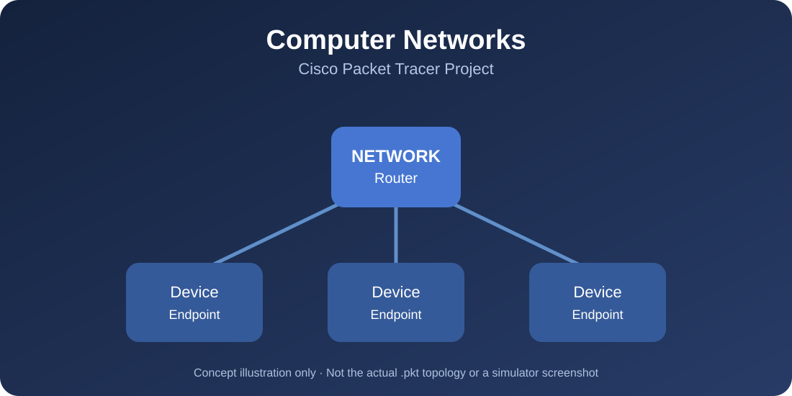

# Computer Networks — Cisco Packet Tracer

**Network simulation project | Cisco Packet Tracer**

*Concept illustration for presentation only. This is not a screenshot or verified topology of the Packet Tracer file.*

## Overview

This repository contains a computer networking assignment prepared using **Cisco Packet Tracer**. The original simulation file is available for inspection in Packet Tracer.

## Project file

📁 **[Open the Packet Tracer project](Nihal_Hameed_Assignment1.pkt)**

The original `.pkt` file is provided without modification.

## Tools

- Cisco Packet Tracer
- Network simulation and configuration

## How to explore the project

1. Install **Cisco Packet Tracer**.
2. Download [`Nihal_Hameed_Assignment1.pkt`](Nihal_Hameed_Assignment1.pkt).
3. Launch Packet Tracer and choose **File → Open**.
4. Select the downloaded file to inspect its network topology and saved settings.
5. Use Packet Tracer's simulation and device tools to check the configuration and connectivity.

## Screenshots

Actual topology and simulation screenshots can be added here after opening the project in Cisco Packet Tracer. The banner above is **illustrative only**, not evidence of specific network devices or successful connectivity.

## Project status

The repository includes the original assignment file. Its topology and connectivity have **not been independently verified** as part of this README update.

## Author

**Nihal Hameed Alharbi**  
[GitHub profile](https://github.com/niha-hameed)
